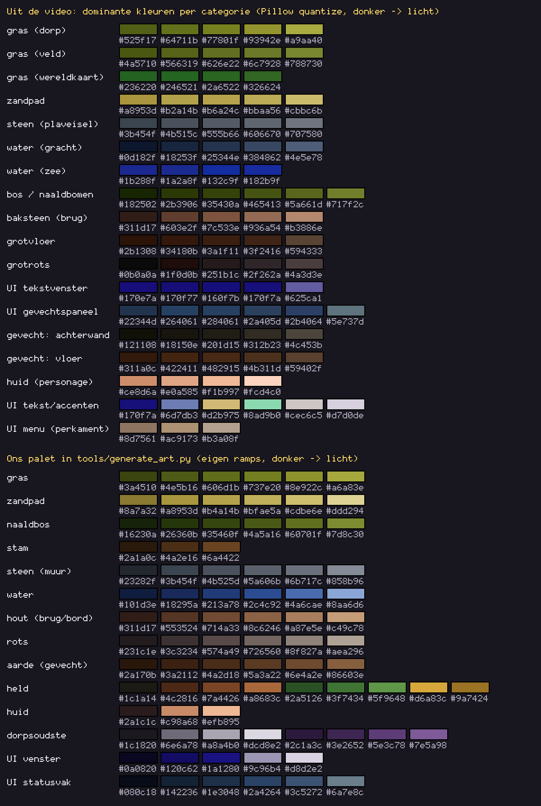

# Stijlgids pixel-art (ARTSTYLE)

Deze gids beschrijft de **beeldstijl** die we voor ons spel gebruiken. Hij is afgeleid uit
een referentievideo van een klassieke SNES-RPG, en vertaald naar **concrete regels** die
`tools/generate_art.py` toepast. Ook nieuwe art die je zelf tekent, volgt deze regels.

> **Belangrijk (copyright):** we nemen alleen de *stijlregels* over (raster, verhoudingen,
> omlijning, palet-aanpak, schaduw, textuur, UI-opbouw). We kopiëren of overtrekken **geen**
> sprites, tiles, personages of namen uit de video. Alle art in `assets/` is eigen werk.
> De `docs/ref_*.png`-uitsneden zijn alleen intern studiemateriaal (zie onderaan).

## 0. Bron en werkwijze

| | |
|---|---|
| Video | *Lufia 2: Rise of the Sinistrals (SNES) complete walkthrough* |
| Kanaal | The Witness: https://www.youtube.com/channel/UCLWjt8XZF7MDn0KzwZ4EszQ |
| Link | https://youtu.be/DaNmNrHYVZw (8:03:23, geüpload 30-12-2023) |
| Wat het laat zien | Een volledige playthrough van *Lufia II* (SNES, 1995): top-down JRPG met dorpen, kerkers met puzzels, een wereldkaart, menu's en turn-based gevechten. |

Hoe ik de stijl heb bekeken:
1. Ik heb de hele video in 1080p gedownload en 93 frames geëxtraheerd: elk hoofdstuk-tijdstip plus elke 2 minuten tussen 10:00 en 2:00:00.
2. Het spelbeeld beslaat in de video x 380..1541 (4:3 uitgerekt). Ik heb het teruggeschaald naar de **originele 256x224 pixels** door per SNES-pixel het midden te nemen. Daardoor kun je de echte pixels tellen.
3. Per categorie (gras, water, steen, ...) heb ik een stuk beeld uitgesneden en met Pillow `quantize()` (median cut) de dominante kleuren bepaald.

Let op: de video is gecomprimeerd (h264). Kleuren kunnen daardoor ±5 % afwijken en kleine details
(1 pixel) zijn soms vervaagd. Animatie kun je uit losse frames niet tellen. Waar iets een schatting is,
staat dat erbij.

---

## 1. Resolutie en raster

| Regel | Referentie | Wij |
|---|---|---|
| Schermresolutie | 256x224 (SNES) | **384x216** (16:9 voor mobiel, blijft zo) |
| Tilegrootte | 16x16 | **16x16** (ongewijzigd) |
| Zichtbaar | 16x14 tiles | 24x13,5 tiles |
| Pixels | strak raster, geen subpixels, geen rotatie of schaal | Nearest-filter + pixel-snap (stond al goed) |

## 2. Personages: verhoudingen

- **Chibi-verhouding:** een personage is ongeveer **16 px breed en 24 px hoog**. Dat is 1 tile breed en 1,5 tile hoog. Het steekt dus boven zijn eigen tile uit.
- **Groot hoofd:** het hoofd met haar is ongeveer de **helft** van de hoogte (±12 px). Daaronder komt een klein lijf met korte benen.
- **Gezicht:** ogen van 1 px breed en 2 px hoog, donker. Geen mond, of hooguit 1 px. Het haar bedekt het bovenste deel van het hoofd en heeft een pony.
- **Grondschaduw:** onder de voeten ligt een kleine, donkere **ovale schaduw**. Ook vijanden in gevechten hebben er een.
- In gevechten zijn de vijanden groter, ongeveer 32 tot 48 px.

**Wij:** de speler- en NPC-sprites zijn nu **16x24** (was 16x16). Het sheet is 48x96: 3 kolommen
(stil, stap A, stap B) x 4 rijen (onder, links, rechts, boven). De `Sprite2D` heeft `offset = (0, -4)`.
Daardoor staan de voeten onderaan de tile en steekt het hoofd 8 px over de tile erboven. De collision
blijft 14x14 op de tile, dus het lopen en de tests veranderen niet. Door y-sort staat wie lager
staat er vanzelf vóór.

## 3. Omlijning (outlines)

| Wat | Regel |
|---|---|
| Tiles (gras, pad, water, muur) | **Geen omlijning.** De vorm komt uit donkere randschaduw en textuur. |
| Objecten op de grond (bomen, rotsen) | **Donkere, gekleurde rand** in de donkerste tint van het materiaal zelf, dus geen zwart. Rechtsonder het donkerst. |
| Personages | Rondom een **donkere, bijna-zwarte omlijning** van 1 px (warm donkergrijs, ±`#1c1a14`, niet `#000000`). |
| Vijanden | 1 px omlijning in een **donkere tint van de eigen kleur** (groen-zwart voor groene monsters, paars-zwart voor paarse). |
| UI-tekst | Lichte tekst met een donkere **schaduw van 1 px** rechtsonder (vooral in menu's). |

## 4. Palet

Algemeen karakter: **gedempt en warm**. Het gras is geel-olijfgroen in plaats van felgroen. Steen is
leisteenblauw-grijs, zand is okergeel en het bos is heel donker olijf. De kleuren zijn rijk in de
middentinten en er is weinig puur wit of zwart. Contrast komt vooral van donkere schaduwen.
Alleen de UI-vensters zijn fel (diep indigoblauw).

### 4a. Gemeten in de video (Pillow quantize, van donker naar licht, % = aandeel in de uitsnede)

| Categorie | Kleuren |
|---|---|
| gras (dorp) | `#525f17` (23%) `#64711b` (24%) `#77801f` (28%) `#93942e` (13%) `#a9aa40` (11%) |
| gras (veld) | `#4a5710` (25%) `#566319` (25%) `#626e22` (21%) `#6c7928` (18%) `#788730` (12%) |
| gras (wereldkaart) | `#236220` (27%) `#246521` (18%) `#2a6522` (35%) `#326624` (21%) |
| zandpad | `#a8953d` (9%) `#b2a14b` (20%) `#b6a24c` (21%) `#bbaa56` (22%) `#cbbc6b` (29%) |
| steen (plaveisel) | `#3b454f` (19%) `#4b515c` (31%) `#555b66` (20%) `#606670` (22%) `#707580` (8%) |
| water (gracht) | `#0d182f` (22%) `#18253f` (29%) `#25344e` (23%) `#384862` (14%) `#4e5e78` (13%) |
| water (zee) | `#1b288f` (26%) `#1a2a8f` (23%) `#132c9f` (27%) `#182b9f` (23%) |
| bos / naaldbomen | `#182502` (20%) `#2b3906` (17%) `#35430a` (16%) `#465413` (20%) `#5a661d` (15%) `#717f2c` (12%) |
| baksteen (brug) | `#311d17` (20%) `#603e2f` (26%) `#7c533e` (28%) `#936a54` (13%) `#b3886e` (13%) |
| grotvloer | `#2b1308` (22%) `#34180b` (28%) `#3a1f11` (21%) `#3f2416` (23%) `#594333` (7%) |
| grotrots | `#0b0a0a` (25%) `#1f0d0b` (22%) `#251b1c` (24%) `#2f262a` (18%) `#4a3d3e` (11%) |
| UI tekstvenster | `#170e7a` (2%) `#170f77` (8%) `#160f7b` (3%) `#170f7a` (72%) `#625ca1` (15%) |
| UI gevechtspaneel | `#22344d` (13%) `#264061` (2%) `#284061` (63%) `#2a405d` (9%) `#2b4064` (5%) `#5e737d` (8%) |
| gevecht: achterwand | `#121108` (22%) `#18150e` (27%) `#201d15` (24%) `#312b23` (15%) `#4c453b` (12%) |
| gevecht: vloer | `#311a0c` (15%) `#422411` (18%) `#482915` (16%) `#4b311d` (33%) `#59402f` (17%) |
| huid (personage, handmatig uit de pixels) | `#ce8d6a` `#e0a585` `#f1b997` `#fcd4c0` |
| UI-accenten | venster `#170f7a`, rand `#d7d0de`, statusnamen `#cec6c5`, HP-label `#6d7db3`, MP-label `#8ad9b0`, schadegetal `#d2b975` |
| UI menu (perkament) | `#8d7561` `#ac9173` `#b3a08f` |

### 4b. Ons palet (in `tools/generate_art.py`, eigen ramps op basis van de metingen)

| Materiaal | Ramp (donker naar licht) |
|---|---|
| gras | `#3a4510` `#4e5b16` `#606d1b` `#737e20` `#8e922c` `#a6a83e` |
| zandpad | `#8a7a32` `#a8953d` `#b4a14b` `#bfae5a` `#cdbe6e` `#ddd294` |
| naaldbos | `#16230a` `#26360b` `#35460f` `#4a5a16` `#60701f` `#7d8c30` |
| boomstam | `#2a1a0c` `#4a2e16` `#6a4422` |
| steen (muur) | `#23282f` `#3b454f` `#4b525d` `#5a606b` `#6b717c` `#858b96` |
| water | `#101d3e` `#18295a` `#213a78` `#2c4c92` `#4a6cae` `#8aa6d6` |
| hout (brug, bordje) | `#311d17` `#553524` `#714a33` `#8c6246` `#a87e5e` `#c49c78` |
| rots | `#231c1e` `#3c3234` `#574a49` `#726560` `#8f827a` `#aea296` |
| aarde (gevechtsvloer) | `#2a170b` `#3a2112` `#4a2d18` `#5a3a22` `#6e4a2e` `#86603e` |
| held (eigen ontwerp) | omlijning `#1c1a14`, kastanjebruin haar `#4c2816` `#7a4426` `#a8683c`, groene tuniek `#2a5126` `#3f7434` `#5f9648`, okergele sjaal `#9a7424` `#d6a83c` |
| dorpsoudste (eigen ontwerp) | grijs haar `#6e6a78` `#a8a4b0` `#dcd8e2`, paarse mantel `#3e2652` `#5e3c78` `#7e5a98` |
| UI venster | `#0a0820` (buitenrand), `#d8d2e2` / `#9c96b4` (rand), `#120c62` / `#1a1280` (vlak) |
| UI statusvak | `#080c18`, `#142236`, `#1e3048`, `#2a4264` (vlak), `#3c5272`, `#6a7e8c` (licht randje) |

Bewust anders dan de held in de video: **geen rood haar en geen blauw harnas**. Onze held heeft
kastanjebruin haar, een groene tuniek en een gele sjaal.

## 5. Licht en schaduw

- **Lichtrichting: linksboven.** Lichte kanten zitten links en boven, donkere kanten rechts en onder. Slagschaduw valt naar **rechtsonder** op de grond. Bomen, muren en gebouwen werpen een duidelijke donkere schaduw op het gras.
- **Tinten per materiaal:** meestal **4 tot 6** (zie de ramps): diepe schaduw, schaduw, midden, licht en soms een extra highlight. Personages hebben 2 à 3 tinten per kleurvlak plus de omlijning.
- **Dithering: nee** (bijna niet). Overgangen gaan met harde stappen of met **textuur** (streepjes, korrels), niet met een dambordpatroon. Ook achtergronden in gevechten gebruiken banden en textuur in plaats van dithering.
- **Overgangen tussen materialen** zijn niet hard. Het gras hangt een beetje over het pad, met een donkere graskant. Een oever geeft een donkere rand op het water. Onder een boom of muur ligt een schaduwband op het gras.

## 6. Textuurdichtheid

De referentie is **druk**: bijna geen tile is vlak.
- **Gras:** korte **verticale streepjes** (halmen) in 3-4 tinten plus wat lichte puntjes, bijna elke pixel kolom heeft variatie.
- **Zandpad:** fijne **korrelruis** (±50 % van de pixels wijkt af van de basis) + kiezeltjes.
- **Steen:** blokken met **ruis** erin, lichte bovenrand, donkere onderrand, donkere voegen.
- **Water:** donkerblauw met **korte horizontale golfjes** en een paar lichte glinsteringen.
- **Naaldbos:** lagen 'hangende' takken (getande onderrand per laag), lichte naaldjes links, bijna zwarte gaten tussen de bomen: een dicht bos leest als één massa.
- Regel van de duim: **textuurdetails van 1-3 px**, nooit grote vlakke vlakken groter dan ±4x4 px (behalve UI).

## 7. UI-vensters

- **Tekstvenster (dialoog):** **vlak diep indigoblauw** (`#170f7a`, geen verloop gemeten), een **lichte lavendelgrijze rand van ±2 px** (`#d7d0de`) met een donkere buitenlijn, en **afgeronde hoeken** (±3 px). Het venster beslaat bijna de hele breedte, met 3 regels tekst. In de referentie heeft het een **spreekwolk-staartje** richting de spreker.
- **Lettertype:** **dun**, met lijnen van 1 px, licht lavendel-wit (`#d0cedc`). Hoofdletters zijn ±9 px hoog, de regelafstand is ±16 px (op 224 px schermhoogte). In de menu's is het lettertype monospace met een 1 px schaduw.
- **Menu's:** soms een **perkament-vak** (beige `#ac9173` met bruine rand) met een klein handje als cursor.
- **Status (gevecht):** onderaan een donkere strook met **4 leisteenblauwe vakken met reliëf** (licht randje linksboven, donker rechtsonder), één per held. Elk vak heeft een naam en gekleurde labels (HP blauwig, MP groenig) met balkjes.
- **Schadegetallen:** warm geel met een donkere rand, springen even omhoog boven het doelwit.

## 8. Gevechtspresentatie

- Achtergrond zonder lucht: boven een **getextureerde 'wand'** (rots of dicht bos), onder een **vloer** (aarde) die vooraan lichter wordt, met horizontale streepjes voor perspectief.
- **Vijanden** in het midden en bovenaan, met een **grondschaduw**. De **party staat linksonder**, van achteren gezien.
- Statusbalk onderaan in een donkere strook (zie 7).
- **Overwinningsscherm** (referentie van Dennis): een groot **doorzichtig 'glazen' venster** over de bovenste helft, met een lichte blauwgrijze ronde rand. Daarin "Gets X EXP.", "Gets X GOLD.", een lege regel en per held "Naam  NXT. LEVEL  getal", met het getal rechts uitgelijnd. De helden blijven eronder zichtbaar.

### 8a. Onze gevechtsprites en het gevechtsscherm (v4)
> Sinds v6 is de gevechts-art **'16-bit plus'** (2x zo fijn): zie **10b** voor de nieuwe formaten en
> schaduwregels. De opstelling, feedback, statusvakken, het overwinningsvenster en het doel-pijltje
> hieronder gelden nog steeds. Alleen de pixelmaten en de ontwerpen van de helden zijn veranderd.

- **Formaat:** een strook van **256x32** per held, met **8 frames van 32x32**:
  0 stil, 1 klaar, 2 aanval A (uithalen), 3 aanval B (slaan), 4 spreuk A (staf omhoog), 5 spreuk B (glinstering), 6 geraakt, 7 KO (liggend).
  De voeten staan op **x=16, y=30**. Het lijf is ±24x30 px, dus groter dan de overworld-chibi (16x24) maar met dezelfde verhoudingen: een groot hoofd.
- **Kijkrichting:** van **achteren, schuin rechts** (rug half naar de speler, gezicht naar de vijanden rechts). Haar en achterhoofd zijn het grootste vlak; van het gezicht zie je alleen een randje wang.
- **Omlijning:** 1 px in een donkere eigen kleur (`#1c1a14`, niet zwart). Het wapen en de arm zijn een aparte laag met een eigen omlijning, zodat ze los blijven van het lijf. Er is een **ovale grondschaduw** onder de voeten.
- **Ontwerpen (eigen werk):**
  - Dennis (krijger): kastanjebruin haar, groene tuniek, okergele sjaal, zwaard
  - Noor (magiër): diep-indigo puntmuts met gouden band, blauwe mantel, staf met amberkleurige bol
  - Lotte (priester): honingblond haar met vlecht, groene haarband, crèmekleurig gewaad met groene zoom, staf met groen blad-kristal
- **Opstelling:** helden schuin in twee rijen linksonder/midden, vijanden rechts. Wie lager staat, wordt ervoor getekend.
- **Feedback:**
  - de actieve held stapt 12 px naar voren
  - een treffer geeft een witte flits, 3 px schudden en de 'geraakt'-pose
  - KO = liggen en grijzig
  - genezen = groene flits
  - vijanden springen 16 px naar hun doel
- **Statusvak** (`hero_status_box.gd`): één leisteenblauw vak met reliëf (`panel_status.png`) per held, 42 px hoog. Erin:
  - de naam (geel = aan de beurt, rood = KO)
  - mini-labels **HP** (lichtblauw) en **MP** (lichtgroen) in een eigen 3x5-lettertje met een donkere rand
  - balken van 5 px met een donkere rand, een licht bovenrandje en een donkere onderrand
  - het getal klein rechts ernaast
  
  Een lage HP (< 25%) maakt de balk oranje. Zonder MP (Dennis) is het label grijs en de bak leeg en donker. Het actieve vak krijgt een gele rand, het gekozen doelwit een witte rand.
- **Overwinningsvenster:** `assets/ui/window_glass.png` (12x12, 9-slice): een doorzichtige donkerblauwe vulling (`#10224e`, alpha ±70%) met een lichte rand (`#c8d8ec`). Het is ±300 px breed en gecentreerd. Ons 16:9-scherm is breder dan de 4:3-referentie: over de volle breedte zouden de kolommen te ver uit elkaar staan.
- **Doel-pijltje:** een geel driehoekje van 11x8 met een donkere rand dat zacht op en neer wipt (`target_cursor.gd`), net boven het hoofd van de held of de vijand.

## 9. Animatie

- Lopen: in de video zie ik per richting **stilstaan + 2 stapposes**. Dat is een schatting: uit losse frames kun je geen framesnelheid meten. Wij houden **3 frames per richting** (stil, stap A, stap B), net als het bestaande `player.gd`.
- Vijanden lijken grotendeels stil te staan en knipperen of schudden bij een treffer. Dat doet onze `battle.gd` al.

---

## 10. Hoe we het toepassen (wat er in v3 is veranderd)

| Onderdeel | Toegepast |
|---|---|
| Tileset | Gemeten palet (geel-olijf gras, okerzand, leisteen, diepblauw water). Geen outlines, licht linksboven, slagschaduw rechtsonder en dichte textuur. **Nieuw:** 25 rand-varianten (gras met schaduw, pad met grasrand, water met oever) die `tools/build_maps.gd` (vroeger `build_main_scene.gd`) automatisch kiest op basis van de buren. De basis-tiles 0-7 zijn gelijk gebleven, dus zelf schilderen in de editor werkt nog. |
| Bomen / rotsen | Eigen naaldboom met lagen takken die de hele tile vult (een rij bomen wordt een dicht bos) en een donkere silhouetrand. Rotsblok met 6 tinten en een schaduw. |
| Personages | **16x24 chibi**, met een groot hoofd, een donkere omlijning (niet zwart) en een ovale grondschaduw. Eigen ontwerpen. |
| Vijanden | Dezelfde eigen vormen als v2, nu met 4 tinten (licht linksboven), een omlijning in een donkere eigen kleur, een gedempter palet en een grondschaduw. |
| Gevechtsachtergrond | Een dicht naaldbos in 3 lagen als 'wand', met een vloer van aangestampte aarde die naar voren lichter wordt. Geen lucht. |
| UI | Een 9-slice venster (`assets/ui/window.png`): diep indigo met een lichte rand en ronde hoeken. Een statusvak met reliëf in leisteenblauw (`assets/ui/panel_status.png`). Een **eigen dun pixel-lettertype "Dauwpixel"** (`tools/generate_font.py`, monospace, 6 px breed, regelhoogte 10 px) met een tekstschaduw van 1 px. Schadegetallen zijn warm geel. |

**Iteraties (wat ik vergeleken en bijgestuurd heb):** zie `style_vs_reference.png` en `style_compare.png`.
1. **Eerste versie:** palet, textuur en 16x24 sprites. In de vergelijking was het gras te donker en te groen. De overgangen gras/pad/water waren hard en de bomen te klein en te los.
2. **Daarna:**
   - de gras-basis is één tint lichter en geler geworden (zoals in de meting: `#77801f` is daar de grootste groep)
   - er zijn automatische randjes bijgekomen (donkere graskant langs het pad, oevers, slagschaduw)
   - de boom is voller gemaakt, zodat bosranden één donkere massa worden
   - de gevechtsachtergrond is nu bos met een aarden vloer in plaats van lucht met bergen
3. **Proef met een lichter boompalet:** de boom verdween in het gras (te weinig contrast). Ik ben teruggegaan naar donkere naalden met lichte highlights en een donkere silhouetrand, zoals in de referentie: daar zijn de bomen ook duidelijk donkerder dan het gras.

**Bewust niet (of nog niet) overgenomen:**
- **Tiles blijven 16x16:** dat is gelijk aan de referentie, en al onze code en tests rekenen in 16 px tiles.
- **Kleiner lettertype dan de referentie** (7 px hoofdletters, 10 px regel in plaats van 9 en 16): ons scherm is maar 216 px hoog en 16:9. Met de grotere maat passen de dialogen en menu's niet meer.
- **Monospace in plaats van proportioneel:** het statusvenster zet HP en MP in vaste kolommen.
- **Geen spreekwolk-staartje** aan het tekstvenster. (De losse statusvakken en de party-sprites in gevechten zijn er sinds v4, zie 8a.)
- **Statusvakken niet over de volle breedte** (v4): op een telefoon liggen links de D-pad en rechts de A/B-knoppen. De vakken staan daartussen, dus ze zijn smaller dan in de referentie, en daarom staan er ook getallen bij.
- **Geen IP-balk** (Lufia 2 heeft 'Ip' voor speciale aanvallen): dat systeem hebben we (nog) niet.
- **Grote bomen (2x2 tiles)** zoals in de dorpen van de referentie bestaan nog niet. Onze boom is 1 tile. Gebouwen zijn er sinds v5 (zie 10a).

## 10a. Dorp en wereldkaart (v5)

Bron: twee telefoonfoto's van Dennis van Lufia 2 (dorpen en de wereldkaart). Ik heb ze alleen
gebruikt om de *regels* af te lezen. Alle tiles zijn zelf getekend in `tools/art_maps.py`.

**Dorp (Wilgendal)**: `assets/tiles/dorp.png` + `huis.png`

| Onderdeel | Regel (uit de referentie) | Hoe wij het doen |
|---|---|---|
| Kasseien | Pleinen en paden van blauwgrijze keien, geen zandpad | Ramp `COBBLE` (`#262a36` → `#8a90a2`). Keien van 3-5 px in rijen die verspringen, licht linksboven, donkere voegen. 15 rand-varianten met een grasrand (masker N1 E2 S4 W8). |
| Huis | Vakwerkhuis met een groot schuin dak, ramen met luiken, een deur in het midden | 5x5 tiles. Paars leien dak (`ROOF`) met een nok, een dakkapel en een schoorsteen. Een lichte gevel (`PLASTER`) met donkere balken (`BEAM`), twee ramen met groene luiken, een houten deur en een stenen plint. Het hele huis blokkeert. De deur is een apart object (`Door`). |
| Heggen, hekjes, muurtjes | Ronde struiken in rijen, lage bakstenen muurtjes, houten hekjes | Een heg (een ronde bol met licht linksboven en schaduw), een hek (palen + 2 latten), een lage muur (ramp `BRICK`). Alle drie blokkeren. |
| Bloemen | Bloemperken met veel kleine stipjes | Een bloemenperk: dichte witte en roze bloemetjes met een geel hartje op gras. Je kunt erover lopen. |
| Rekwisieten | Tonnen bij de huizen | Een houten ton op kassei, met twee metalen banden. Blokkeert. |

Het dorp houdt het gras en de bomen van v3 (geel-olijf, zie 4b), zodat de stijl van het dorp gelijk
blijft aan de oude map.

**Wereldkaart**: `assets/tiles/wereld.png` (raster van 16 kolommen)

De wereldkaart heeft een andere schaal: kleinere dingen per tile, en de kleuren zijn feller en
groener dan in het dorp, net als in de referentie. De speler is dezelfde sprite.

| Terrein | Ramp | Regel | Varianten |
|---|---|---|---|
| Gras (vlakte) | `WG` `#1c4416` → `#68a046` | Egaal middengroen met fijne korrels, bijna geen streepjes | 2 (de builder wisselt ze af) |
| Licht gras | `WL` `#466e1e` → `#bcd66a` | Geelgroene vlekken met een kartelrand en verticale grassprietjes | 16 (masker) |
| Zand | `SAND` | Okervlekken met korrels en een zachte rand | 16 |
| Bos | `FOREST` `#061208` → `#346230` | Dichte ronde boomkruinen in een verspringend rooster van 8 px op een zwarte bosgrond, licht linksboven. Aan de rand een kartelige rij halve kruinen. Je kunt erdoor lopen. | 16 |
| Bergen | `MOUNT` `#3e3228` → `#e6dcc6` (bleek beige) | Puntige rotsheuvels, licht linksboven, donkere voet. In een keten overlappen ze in **verspringende rijen**: één heuvel in het midden van elke tile, plus een 'tussenheuvel' op elke tilehoek waar ook bergen liggen. Losse bergen hebben een slagschaduw op het gras. Blokkeert. | 2x16 (A/B als een dambord) |
| Zee + kust | `SEA` `#0c1452` → `#7890d8` | Diep verzadigd blauw. De kust heeft een donkerbruine rotsrand, een rij witte schuimstipjes en een strook ondieper water. | 47 (masker met zijkanten + hoeken) |
| Stad-icoon | `ROOF`, `BRICK` + blauw | Een groepje huisjes van 2 tiles breed: een paars dak, een blauw dak, een roodbruin dak en een boompje | 2 |
| Trap | `STONE` | Ronde opening met een stenen rand en treden die naar onder toe donkerder worden | 1 |

**Gevechtsachtergronden per terrein:**
- `backdrop_bos.png`: de bosrand uit v3, voor gevechten in het bos
- `backdrop_vlakte.png`: verre blauwgroene heuvels, een rij beige rotsheuvels en struiken als
  'wand', met een grasvloer. Voor gras en zand.

Ook hier geen lucht, zoals in de referentie.

**Iteraties (vergeleken met de foto's):**
1. **Eerste versie:** de bergen waren één heuvel per tile met donkere rotsgrond ertussen. Dat
   leek op een raster van losse bulten. Het stad-icoon was te klein (huisjes van 5-6 px hoog).
2. **Daarna:**
   - de bergen zijn bleker beige geworden en overlappen in verspringende rijen, zodat een keten
     één massa wordt, zoals in de referentie
   - het stad-icoon vult nu de hele tile (drie huisjes met paars, blauw en roodbruin dak)
   - het dorp heeft een extra bloemenperk gekregen (een vijvertje met de oude watertiles bleek te
     hoekig: die tiles hebben geen oever aan de onderkant)

**Bewust anders dan de referentie:**
- **Kustlijn per tile.** In Lufia 2 is de kust ronder: die tekent ook halve tiles. Wij doen het
  met 47 varianten per tile. De kust is dus wat hoekiger, maar werkt automatisch.
- **Het dorp is groter en leger.** Er staat nog maar één huis, zoals gevraagd.

## 10b. '16-bit plus' – het gevechtsscherm (v6)

Dennis koos na het bekijken van mockups voor **'16-bit plus'**: ongeveer **2x zo veel pixeldetail**
als onze gewone art. Het moet lijken op een late SNES/GBA-JRPG van het hoogste niveau, maar wel
**scherpe retro pixel-art** blijven in ons eigen palet (olijfgroen, aardebruin, diep indigo). Dit
geldt voorlopig **alleen voor het gevechtsscherm**. Overworld, dorp en wereldkaart blijven zoals
ze zijn (16x16-tiles, 384x216).

### Resolutie
- Tijdens een gevecht rendert het venster op **768x432** in plaats van 384x216
  (`content_scale_size` x 2, constante `DETAIL = 2` in `battle.gd`). Na het gevecht gaat dat terug.
- De scène zelf en de touch-knoppen staan op **schaal 2**. Alle lay-out, tikken en tests rekenen dus
  nog gewoon in 384x216-eenheden.
- Alle gevechts-art is **2x zo fijn getekend** en staat op **schaal 0.5**. Daardoor is
  **1 art-pixel = 1 echte pixel** op het fijne raster: nergens halve of uitgerekte pixels, geen blur.
- UI-vensters: dezelfde indigo vensters, nu als **24x24-texture met een marge van 8**
  (`assets/ui/*_hd.png`). Godot behandelt ze als 12x12 (`hd_ui.gd`), dus de randen zijn **1 fijne
  pixel** dik. De lay-out is precies dezelfde als in v4.
- Lettertype: Dauwpixel blijft **10 px** (in gewone eenheden; op het fijne raster dus 2x2-pixels).
  Een kleinere letter zag er fijner uit, maar was op een telefoon slecht leesbaar:
  **leesbaarheid gaat voor**. Lijntjes en balken in de statusvakken gebruiken wel halve eenheden
  (= 1 fijne pixel): een gouden rand van 3 tinten en een balk met glans en schaduwrand.

### Formaten

| Wat | Plaatje (art-pixels) | Op het scherm (eenheden) | Voeten |
|---|---|---|---|
| Held (8 poses) | strook 640x80, frames van **80x80**; figuur **±55 px** hoog (Octopath-achtig) | 40x40, figuur ±28 hoog | (40, 77) in het frame |
| Goblin | 64x72; figuur ±70 px hoog (groter dan de helden) | 32x36 | midden-onder, vlak boven de rand |
| Slijm | 78x62; ±40 px hoog, glanzend | 39x31 | idem |
| Vleermuis | 79x69 (zweeft in het plaatje boven zijn eigen schaduw) | 39,5x34,5 | idem |
| Achtergrond bos / vlakte | **1280x432** | 640x216 (op 16:9 zie je het middelste deel) | horizon op ±y 170 |
| Vensters | 24x24, marge 8 | als 12x12, marge 4 | – |
| Doel-pijltje | 21x15 fijne pixels | 11x8 | punt op (5, 7) |

**Ontwerp-eenheden.** Helden zijn ontworpen in een raster van 96x96 'eenheden' en worden op
**schaal 5/6** getekend (`Canvas(..., scale)` in `art_battle.py`), de goblin op 0,5, de slijm op 0,7
en de vleermuis op 0,62. De omlijning, plooien en lokken blijven altijd **1 pixel** dun: kleiner
tekenen = minder detail, niet dunnere lijnen. Op deze maat (±55 px, zoals Octopath Traveler) blijft
het detail dat de code tekent schoon: elke plooi en lok is nog een eigen pixel-rij, zonder
'gruis'. Vijanden worden in het spel altijd op precies de helft getoond (niet afgerond, dus
een oneven breedte als 79 blijft 79 echte pixels).

**Kadrering (dichte camera).** Het slagveld vult de ruimte tussen het berichtvenster en de
statusvakken:
- de helden staan **op een rij naast het menu**, met hun voeten op y ±140-146 (eenheden), 30
  eenheden uit elkaar, net rechts van het menu
- een 4e held staat in de achterste rij ertussen
- de vijanden staan rechts; de goblin is iets groter dan de helden (±70 tegen ±55 fijne pixels)
- in de zichtbare hoeken van de achtergrond staan grote donkere **voorgrond-varens, struiken en
  bemoste stenen**, die het beeld omlijsten

**Silhouetten.** Dennis heeft een karmijnrode cape (half lang, zodat de groene tuniek eronder zichtbaar
blijft) en stalen schouderstukken. Bij een aanval waait de cape naar achteren. Noor heeft een
puntmuts en een schoudermantel. Lotte heeft een saliegroen manteltje met kap.

De 8 poses zijn dezelfde als in v4: stil, klaar, aanval A (uithalen), aanval B (slaan),
spreuk A (staf omhoog), spreuk B (gloed), geraakt, KO (liggend, zonder wapen, ledematen langs het lijf).

### Schaduwregels (hoe het 'duurder' oogt zonder blur)
1. **Licht van linksboven-voren** (zoals altijd). Elke vorm (hoofd, arm, mouw, staf, slijm) wordt als
   **3D-vorm** belicht: een bol, een cilinder of een kegel. Daarna wordt de tint **afgerond naar een ramp van
   6 tinten**. Er zijn geen tussenkleuren en er is geen dithering.
2. **Ramps van 6 tinten met hue-shift.** De schaduwen worden koeler en paarser, de lichten warmer en
   geler (zie `tools/art_battle.py`, bv. `TUNIC`, `ROBE_BLUE`, `SKIN`). Elke kleur komt uit zo'n ramp.
3. **Selectieve omlijning.** De rand is donker (`#120a10`) aan de schaduwkant. Aan de lichtkant is hij de
   op één na donkerste tint van het materiaal zelf. Nergens puur zwart.
4. **Diepte-randen.** Waar een voorste deel (arm, wapen) over een achterste deel valt, krijgt het
   achterste deel een rand die 2 tinten donkerder is. Zo blijven armen en wapens los van het lijf.
5. **Plooien en lokken** zijn korte lijnen van 1 tint donkerder, met soms 1 tint lichter ernaast.
   Je ziet ze in mantels, tunieken, haar en schors.
6. **Glans** alleen op harde of natte dingen. Staal krijgt een witte lichtstreep, de slijm een harde
   witte vlek, ogen een glinsterpixel.
7. **Grondschaduw.** Onder elke figuur ligt een ovale, half doorzichtige schaduw.
8. **Achtergronden in tinten, niet in kleuren.** Elke pixel heeft een materiaal (blad, schors, aarde,
   gras, steen, rots, ...) en een tint-index. Licht en diepte zijn een tint +1 of -1. Dat geldt voor
   lichtvlekken, lichtbundels door het bos en de donkere voet van struiken. Het blijft dus altijd palet.
9. **Luchtperspectief.** Ver weg is lichter, grijzer en heeft minder contrast (nevel tussen de verre
   dennen). Dichtbij is donkerder, verzadigder en gedetailleerder. Textuur op de vloer wordt groter
   naar voren (perspectief). Er is nog steeds **geen lucht** (zie 8): de bovenkant is een 'wand'.
10. **Lagen voor diepte** (bos): nevelige verre dennen, dan donkere dennen met stammetjes, dan een
    donkere onderbegroeiing, dan grote stammen met schors, mos en een kruin. Daarna struiken en varens
    over de bosrand, een open plek van aangestampte aarde met grasplekken, graspollen, kiezels en
    blaadjes, en stenen en varens in de hoeken. De vlakte heeft dezelfde opbouw: donkere verre
    heuvelruggen, bleke rotsheuvels, dennetjes en struiken, en een grasvloer met aardeplekken en
    bloemetjes.

### Werkwijze en iteraties
- Alles is **met code getekend** (`tools/art_battle.py`: helden, vijanden, vensters;
  `tools/art_battle_bg.py`: achtergronden). Het is eigen werk. De AI-mockup diende alleen als
  stijlrichting: we namen geen party, namen, getallen of vormen over.
- **Helden, 5 rondes:**
  1. eerste opzet
  2. frame 96 i.p.v. 80, meer contrast, haar en wang, donkerder staal
  3. minder pieken in het haar, Lotte's lint als strik in de nek, kleinere zwaaibogen
  4. nette KO-pose: voeten plat, ledematen langs het lijf, Noor's hoed af
  5. na het eerste screenshot in het spel: Dennis' haar was een 'dennenappel' met pieken alle kanten
     op. Nu is het één bos haar die het achterhoofd tot de kraag bedekt, met een paar brede pieken
     naar achter-boven, áchter de bos getekend, zodat de bos zelf niet donker wordt
- **Vijanden, 3 rondes.** De goblin z'n hoofd ging omhoog, zodat de bek met slagtanden zichtbaar is.
  De knots-arm ging naar buiten en de neus kreeg een schaduw. De slijm kreeg een zachtere kern.
- **Koerscorrectie (Dennis, na vergelijking met de mockup).** De art was te klein en te ver weg. Daarom:
  - helden van ±64 naar **±110 px** (schaal 5/3), met capes en mantels
  - de slijm en de vleermuis 1,35x groter
  - een dichte camera: helden op een rij, de vijanden even groot, het slagveld vult het beeld
  - grote voorgrond-varens en struiken in de hoeken, en warmer licht
  - Dennis' haar opnieuw als grote plukken, zodat het bij deze grootte niet glad wordt
- **Tweede koerscorrectie (Dennis): Octopath-hoogte.** ±110 px was te groot: de code-detail werd
  daar vlak. Nu zijn de helden **±55 px** (schaal 5/6, frames 80x80), de goblin **±70 px**, de slijm
  **±40 px** en de vleermuis 79x69. De dichte camera, de voorgrond en de capes/mantels bleven; de
  helden staan dichter bij elkaar (30 eenheden uit elkaar) en de vijanden schoven iets naar links.
- **Achtergronden, 4 rondes** (de 4e is die koerscorrectie: voorgrond en warmer licht):
  1. strepen op de vloer, een grijze band onder de dennen en een vlakte met lucht. Afgekeurd.
  2. luchtperspectief, een gebroken vloertextuur en een vlakte zonder lucht
  3. gevarieerde dennen, donkerdere grasplekken met een rand, schaduwen in het vloermateriaal en
     rotsheuvels met korte breuklijnen en gras bovenop

## 10c. 'De Vergeten Bibliotheek' (v7) – NIEUWE HOOFDSTIJL

Vanaf v7 is dit de stijl van het gevechtsscherm en van ALLE vensters (ook het tekstvak in
de overworld). Richting van Dennis: *verval van een digitale wereld* x *dark academia*.
Donker en grijs, met neon **magenta** en **cyaan** alleen als accent, plus scanlines.
Bron: twee AI-mockups van Dennis (alleen stijlrichting; personages niet 1-op-1 gekopieerd).
Zie hoofdstuk 13 voor het palet. De overworld-tiles (dorp/wereldkaart) zijn nog v5.

### Sfeer in één zin
Een vergeten, grijze bibliotheek die langzaam 'kapot gaat' als een oud bestand: zwarte
pixelblokjes, losse stukjes binaire code (`0101`) en verschoven glitch-banden; daartussen
heel af en toe een magenta of cyaan oplichtend pixeltje.

### Vensters (UI)
- Houtskool-grijze vulling (`#151518`), **dunne lichtgrijze rand** (`#a6a6ac`) met een donkere
  binnenlijn, **afgeschuinde metalen hoekplaatjes met een klinknagel** in elke hoek
  (`tools/art_v7_ui.py`).
- In het tekstvak: **pixel-ruis** (scripts/ui/glitch_noise.gd): grijze blokjes en streepjes,
  dicht langs de randen en in een paar 'storingsvlekken', rustig in het midden (tekst blijft
  leesbaar). Flikkert heel af en toe 0,08 sec.
- **Titel-tabje** boven het berichtvenster: *De Vergeten Bibliotheek*; boven het commandomenu
  staat de naam van de held; in de overworld de naam van wie praat (in magenta).
- Commandomenu met **▶-pijltjes** (getekend, het lettertype heeft geen ▶); de selectie krijgt
  een magenta gloed + gevuld pijltje.
- Statusvakken: naam, `HP`- en `MP`-balk met de getallen rechts óp de balk (`28/28`).
  Balken grijs; **HP magenta** voor de held die aan de beurt is én voor de magiër (Noor);
  **MP altijd cyaan**; lage HP (< 25%) rood-roze. Actieve held: naam magenta + magenta rand.
- Touch: grijze metalen **D-pad met magenta 'printplaat'-sporen**, A/B grijs met een **neon
  rand** (A cyaan, B magenta).
- Doel-pijltje: neon magenta met donkere rand. Schadegetallen wit, genezing cyaan.

### Scanlines / CRT
- Autoload `Crt` (scripts/ui/crt_overlay.gd): over het hele scherm dunne donkere lijnen
  (om de andere beeldpixel), een licht vignet, en elke 7-16 sec een glitch van ±0,1 sec
  (rood/blauw schuiven uit elkaar, een smalle band verspringt).
- **Alle instellingen op één plek: `CRT` in scripts/data/game_data.gd** (aan/uit, sterkte in
  het gevecht en in de overworld, vignet, glitch aan/uit, aberratie). Tijdens het spel:
  `Crt.set_enabled(false)`. Vangt geen tikken af.

### Gevechtsachtergrond (`tools/art_v7_bg.py`)
- Grote bibliotheekzaal in perspectief (eenvoudige ray-caster): hoge boekenkasten met bogen
  en zuilen, een verre deuropening, stenen vloer met tegels.
- **Bijna alleen grijs** (gekwantiseerd in banden, geen verloop), met digitale aantasting:
  zwevende zwarte pixelvierkantjes, losse `0101`-regels, glitch-banden, een 'gescheurde'
  vloer met binaire tekst; donkere bladeren en puin in de hoeken op de voorgrond.
- Neon alleen als stipjes (een paar magenta/cyaan pixels in de code-wolkjes).
- Variant `bibliotheek_overwoekerd.png` (meer groen/bladeren) voor gevechten in het bos.

### Helden (`tools/art_v7_heroes.py`)
- **Groot**: frame 160x160, figuur ±112 fijne pixels (2x v6), 3/4 van achteren, op een rij
  links, kijken naar rechts. Voeten op (80, 154). 8 poses + grondschaduw (zoals v6).
- Gedempt palet (grijs, bruin, leer); **neon alleen op magie en wapens**.
- **Randlicht**: elke pixel met een lege buur links of boven wordt 38% naar `#cecede`
  getrokken (licht van linksboven). Zo komen donkere figuren los van de grijze zaal.
- Dennis: bijna zwart haar met bruine glans, donkere cape met bronzen boom-rune, grijs
  harnas en schouderstuk; **zwaard dat vanaf het midden in pixels uiteenvalt** (cyaan/magenta).
- Noor: bruine paardenstaart, donkere kapmantel, staf met **gloeiende magenta bol**.
- Lotte: grijs-witte gewaden, as-blonde vlecht, **cyaan** zoom/sjerp en een staf met cyaan kristal.

### Vijanden (`tools/art_v7_enemies.py`)
- **Het Kennis-Beest** (baas, groter dan de helden): golem van gestapelde boeken en perkament,
  een opengeslagen boek als kop, een kern van magenta binaire code, een boekenhamer.
- **Papiergeest**: geest van bladzijden met binaire tekst en een simpel gezichtje.
- **Glitchmot**: vliegende mot met vleugels van vergeeld papier (nerven, binaire tekst),
  donker lijf, cyaan oogvlekken, randen die in pixelblokjes uiteenvallen.
- Zelfde randlicht als de helden (30%).

### Werkwijze en iteraties (v7)
1. Eerste versie naast de mockup gelegd: helden te klein en te grauw (verdwenen tegen de
   grijze kasten), Glitchmot onleesbaar donker, ruis in het tekstvak te druk, getallen op de
   balken slecht leesbaar.
2. Helden 140 → 160 px frames (±97 → ±112 px figuur), randlicht toegevoegd, Dennis' haar
   minder stekelig/bruiner, helden verder uit elkaar; Glitchmot kreeg papieren vleugels;
   ruis in het midden rustiger; donker plaatje achter de balk-getallen.
3. Verticale indeling: slagveld ±42% bovenin, berichtvenster + menu ertussen, statusvakken
   onderin tussen D-pad en A/B. De autotest controleert dat niets overlapt.
Bewust anders dan de mockup: D-pad links / A/B rechts (duimen), getallen kleiner (100/100
i.p.v. 228/228, ons spel begint op level 1), onze eigen helden (Lotte i.p.v. Gunnar).

## 10d. v8 – grotere helden en de wereld in 'De Vergeten Bibliotheek'

### Helden (`tools/art_v8_heroes.py`)
- **±35% van de schermhoogte** (zoals de mockup): frame **210x210**, figuur ±155 fijne pixels,
  voeten op **(105, 203)**. Op het scherm op halve grootte (±78 van de 216 eenheden).
- **Warmer en leesbaarder**: echte huidtinten, bruin leer, eigen haarkleur per held, glimmend
  metaal met lichte toppen. Capes zijn donker (niet blauwgrijs) zodat leer, haar en huid
  eruit springen: Dennis antraciet met **rode voering** en bronzen rune, Noor donker pruim,
  Lotte crème gewaad met **rood manteltje**. Warm randlicht `#e2dace` van linksboven.
- **Dynamische houding**: bovenlijf leunt naar voren (naar de vijand), wapen geheven, brede
  stand. Silhouet eerst: wapen en hoofd steken vrij uit, de cape hangt aan de achterkant
  (rechts zie je lijf en arm).
- **Idle-animatie** in de strook: frame 8 = inademen (bovenlijf 1 eenheid omhoog, cape zwaait
  naar achteren, bol/kristal feller), frame 9 = uitademen. `battle_hero.gd` speelt
  8-0-9-0 (0,42 s per stap) zolang de pose 'stil' is, met een eigen fase per held.
- Strook = 10 frames: 0 stil, 1 klaar, 2-3 aanval, 4-5 spreuk, 6 geraakt, 7 KO, 8-9 adem.

### Vijanden (`tools/art_v8_enemies.py`)
- **Papiergeest**: geen lief lakentje meer maar een **prop verfrommelde bladzijden** (hoekige
  vellen met knikken, afwisselend wit papier en vergeeld perkament), binaire tekst en
  handschrift, donkere ogen, een gescheurde grijns met tandjes en wegvliegende snippers.
- **Het Kennis-Beest**: meer boek-detail: vergulde banden op een deel van de ruggen
  (niet allemaal: anders wordt het streperig), leeslinten, extra boeken, losse vellen en met
  beschreven perkament omwikkelde armen. Plaatje 171x185.
- **Sinds v8 tekent de art director de helden en vijanden met de hand** (zie
  `tools/handwerk.txt`); de generatoren hierboven zijn placeholders. Regels voor
  vervangende art: helden 2100x210 (10 frames, voeten (105,203), figuur ±155 px); vijanden
  losse PNG naar links kijkend, grondschaduw midden-onder (midden 6 px boven de onderrand),
  max. 194 px hoog. Overworld-art: `docs/art_specs/TILESET_SPEC.md`.

### Dorp en wereldkaart (`tools/art_v8_maps.py`)
- **Zelfde tiles, nieuwe huid**: alle tiles staan op dezelfde plek (dorp.png 864x16,
  huis.png 80x80, wereld.png 256x144), dus kaarten, botsingen en doorgang zijn ongewijzigd.
  `art_v8_maps.py` vervangt de paletten van `generate_art.py`/`art_maps.py` en tekent een
  paar tiles opnieuw.
- **Palet**: ontkleurd mosgroen gras, as-grijze paden, grijze plavuizen, groenzwarte leien,
  natuursteen, leisteen-zee, grijze bergen, bijna zwart bos (zie hoofdstuk 13).
- **Architectuur**: het huis is een kleine bibliotheek (natuursteen in verband, pilasters,
  kroonlijst met binaire inscriptie, hoge boogramen met boekenkasten, roosvenster in de
  dakkapel, boogdeur met ijzerbeslag, twee lantaarns, klimop). Tonnen werden lantaarns op
  een sokkel, hekken smeedijzer, de lage muur natuursteen met mos. Stad-icoon: bibliotheek
  met fronton, zuilen en boekruggen, plus een half ingestort torentje.
- **Digitaal verval spaarzaam**: neon (magenta/cyaan) alleen op unieke objecten (kapotte
  leien op het dak, roosvenster, stad-icoon). Niet op tiles die zich honderden keren herhalen,
  anders wordt het een patroon (iteratie 1 had neon in het bloemenperk: weggehaald).
- **Figuren (16x24)**: Dennis met donkere cape (op de rug een bronzen embleem), leren tuniek,
  grijze kraag/schouders, donkerbruin haar. De Oude Wijze als geleerde: grijs haar,
  grijsgroene mantel, perkamenten kraag. Donkere omlijning `#0c0b0b` zodat ze ook op een
  telefoon loskomen van de grijze keien.

### Werkwijze en iteraties (v8)
1. Helden naar 210-frames en warme ramps; naast de mockup: capes lazen als blauwgrijze
   blokken, hoofden als haarballen. Papiergeest leek een bloemkool/wolkje.
2. Capes donkerder en smaller aan de voorkant (lijf en arm zichtbaar), rode voering, oor
   zichtbaar; Papiergeest met hoekige, geknikte vellen; minder vergulde banden.
   Indeling: Kennis-Beest iets kleiner (190 → 185) en menu 3 px lager, want de baas viel
   over het menu-tabje (autotest).
3. Dorp/wereld: eerste versie te donker en eentonig, stad-icoon onleesbaar, neon herhaalde
   zich in de bloemen-tiles. Daarna: lichter gras, plavuizen-ruïnes, puin, nieuw stad-icoon
   met zuilen, neon alleen op unieke plekken.

## 10e. v9 – gevechtsindeling zonder berichtvenster

- Geen groot berichtvenster meer: de party krijgt die ruimte. Helden en vijanden staan op één
  grondlijn met de voeten rond y 124 (van 216); de baas past daardoor ruim onder de rand.
- Berichten: smalle strook bovenin, gecentreerd, zo breed als de tekst, vulling
  `#0e0e11` op 74% dekking met een dun magenta lijntje onder (1 eenheid, 55%). Witte tekst.
  Vervaagt na ±1,8 sec; blijft staan tijdens kiezen/tikken.
- Commandomenu = pop-up direct boven het statusvak van de actieve held (linkerkanten gelijk,
  geklemd tussen D-pad en A/B), schuift in 0,18 sec (cubic, ease-out) naar de volgende held.
  Het menu mag over de benen van de figuren vallen (het is tijdelijk), nooit over statusvakken,
  de strook of de knoppen. Submenu's (Magie/Item/Doel) op dezelfde plek, met klein tabje.

## 10f. v9.1 – voor-achter-opstelling

- Party onderaan, elke held midden boven zijn eigen statusvak (van achteren gezien).
- Vijanden bovenin op één rij, horizontaal gecentreerd, getoond op 0,88x (verder weg), voeten
  rond y 102 van 216, nooit over de bericht-strook. Het doel-pijltje blijft onder de strook.
- Nodig van de art director: **helden in rugaanzicht (kijkend omhoog)**, zelfde strip-formaat
  (2100x210, 10 frames van 210x210, voeten op (105,203)); **vijanden in vooraanzicht (kijkend
  naar de camera, omlaag)**, losse PNG's met grondschaduw midden onderaan, zelfde hoogtes.

## 10g. v0.10 – binnen, opslagboek, gevechtsachtergronden, nieuwe monsters

Alles hieronder staat in `tools/handwerk.txt`: een bestand van de art director er overheen
zetten is genoeg (zelfde pad, zelfde formaat), de code hoeft niet te veranderen.
Placeholders maakt `python3 tools/art_v10.py` (alleen als het bestand er nog niet is).

**Binnen-tiles** `assets/tiles/binnen.png`: **384x16**, één rij van **24 tiles van 16x16**,
RGBA. Index (kolom) – betekenis – blokkeert?
 0 vloer (hout) – nee · 1 vloer variant – nee · 2 kroonlijst/bovenkant muur – ja ·
 3 muur boven – ja · 4 muur onder (lambrisering) – ja · 5 boekenkast boven – ja ·
 6 boekenkast onder – ja · 7 raam boven – ja · 8 raam onder (vensterbank) – ja ·
 9 zijmuur links – ja · 10 zijmuur rechts – ja · 11 voormuur (onderrand kamer) – ja ·
 12 deur/uitgang (met mat) – nee · 13-15 tapijt boven links/midden/rechts – nee ·
 16-18 tapijt onder links/midden/rechts – nee · 19 bed hoofdeinde – ja · 20 bed voeteneinde – ja ·
 21 tafel links – ja · 22 tafel rechts (kaars) – ja · 23 kandelaar (staand) – ja.
Muren/kasten/raam staan 2 tiles hoog (boven + onder); kamerindeling in `tools/build_maps.gd`
(`INSIDE_MAP`). Collision zit in `binnen.tres` (opnieuw bouwen met `tools/build_maps.tscn`).

**Opslagboek** `assets/sprites/save_book.png`: **64x16**, **4 frames van 16x16** naast elkaar,
RGBA, open boek op een houten lessenaar, frame 0 zacht gloeien → 1 sterker → 2 sterkst +
bladzijde omhoog → 3 sterker; speelt 0,22 s per frame in een lus. Het object blokkeert 1 tile.

**Gevechtsachtergronden** `art/battle_bg/{gras,zand,boss}.png`: **1280x432 RGB** (2x-raster van
640x216). Getoond 'cover': op 16:9 zie je het middelste 768x432-stuk, op bredere telefoons
meer van de zijkanten. Horizon rond 1/3 (y ≈ 140-170). **Vijanden** staan met hun voeten op
y ≈ 204 (2x-raster) in het midden; **de helden** staan onderaan (voeten y ≈ 346), de
onderste ±80 px iets donkerder. Baas: de vijandenrij wordt horizontaal gecentreerd op
`BACKDROP_STAGE["boss"]` (nu x 800 in de art = midden van de magenta cirkel); de hoogte
blijft y ≈ 204.

**Vijanden (vooraanzicht)** `art/enemies/<id>.png` (nu `mosslijm.png`, `moskonijn.png`):
RGBA, getekend op het 2x-raster, kijkend naar de camera, grondschaduw midden onderaan
(voeten = midden, 3 px van de onderrand). Getoond op 0,44x (2x-raster x 0,88 'verder weg').
Richtmaat: klein monster 70-90 px hoog (placeholder Mosslijm 80x56, Moskonijn 80x100),
groot/baas tot 194 px hoog (hoger wordt automatisch verkleind).

## 10h. v0.11 – proloog: put, zegels, kist, schilderij, ingang van de Archieven

Nieuw in `assets/sprites/story/` (nu placeholders uit `tools/art_v11.py`, beschermd via
`tools/handwerk.txt`; echte art er gewoon overheen zetten):

- `put.png` 16x24 (1 frame; onderste 16 px = de tile, dakje steekt 8 px uit)
- `zegel.png` 32x16 (0 = dof teken, 1 = gecontroleerd, zwak cyaan)
- `kist.png` 32x16 (0 = dicht, 1 = open)
- `schilderij.png` 32x16 (0 = recht, 1 = scheef met lege haak) – over een muur-tile binnen
- `archief.png` 64x32 (2 frames van 32x32 = 2x2 tiles: 0 = overwoekerd, 1 = open, roze licht)

Licht en tijd van de dag doet de engine: zachte additieve gloed (zegels cyaan, open ingang
magenta), avond/nacht via een tint (CanvasModulate) en in scène 2 lichtbundels door de ramen
(binnen-tile 4). De art hoeft dus geen gloed of nachtversie te hebben. Gewenst van RPG ART (zie
`/workspace/art_specs_v11/ART_SPEC_V11.md`): een eigen Oude Man (48x96, ook met zwaard),
Dennis liggend in bed (16x32) en lezend op de stoel (16x24), en optioneel een huis met
verlichte ramen voor de nacht.

## 10i. v0.11 – boekpunten (opslaan / HP / MP)

- Drie boeken op een lessenaar, allemaal **64x16 = 4 frames van 16x16** (RPG ART,
  `art_interior_v10/out/`): `save_book.png` (cyaan, = `savepunt.png`), `hp_book.png` (rood,
  = `savepunt_rood.png`), `mp_book.png` (groen, = `savepunt_groen.png`).
- De aura komt uit de code (additief, straal 44 px, alpha 0,25..0,6, schaal 0,88..1,08,
  1,8 s): cyaan `#3ff0ff`, rood `#ff3f4f`, groen `#3fff7a`. Niet in de PNG tekenen.

## 11. Checklist voor nieuwe art

1. Raster 16x16 voor tiles (gebouwen: een blok van meerdere tiles, zoals het huis van 5x5), 16x24 voor personages (sheet 48x96). **Gevechts-art is '16-bit plus' (zie 10b):** helden 80x80 per frame (strook 640x80, 8 poses, voeten op 40,77, figuur ±55 px), vijanden 2x zo fijn (goblin ±70 px hoog, slijm ±40 px), achtergronden 1280x432, vensters 24x24.
2. Gebruik kleuren uit de ramps hierboven (of bouw een nieuwe ramp van 4-6 tinten: donker → licht, iets warmer naar licht toe).
3. Licht van **linksboven**; schaduw valt naar **rechtsonder**.
4. Tiles: **geen** omlijning. Personages en vijanden: 1 px donkere omlijning, **niet** puur zwart.
5. Geen dithering; gebruik textuur (streepjes/korrels van 1-3 px).
6. Grote vlakke vlakken vermijden (behalve UI).
7. Personages: hoofd ± de helft van de hoogte, grondschaduw onder de voeten.
8. Teken altijd zelf. Gebruik referenties alleen om de regels te snappen, nooit om over te trekken.

## 12. Referentiebeelden (alleen intern)

In deze map staan een paar kleine uitsneden uit de video. Ze zijn bedoeld om de regels hierboven te
begrijpen. **Dit is materiaal van de video/het originele spel: niet meeleveren, niet gebruiken in het
spel.** De map `docs/` heeft een `.gdignore`, dus Godot importeert of exporteert deze bestanden niet.

| Bestand | Inhoud |
|---|---|
| `ref_dorp_pad_bos.png` | Dorp met zandpad en naaldbos (160x120, 2x): gras-textuur, padranden, dicht bos |
| `ref_personage.png` | Personage op de wereldkaart (36x38, 4x): verhoudingen en omlijning |
| `ref_dialoogvenster.png` | Tekstvenster (216x90, 2x): kleur, rand, lettertype, staartje |
| `ref_gevecht.png` | Gevechtsscherm (256x224, 2x): wand + vloer, vijand met schaduw, statusvakken |
| `palette.png` | Paletkaart: gemeten kleuren + ons palet (dit is wél eigen werk) |

## 13. Palet 'De Vergeten Bibliotheek' (v7, aangevuld in v8)

Ramps van donker naar licht. Code: `tools/art_v7_common.py` (art) en `scripts/ui/ui_style.gd` (UI).

| Naam | Hex | Gebruik |
|---|---|---|
| Venster | `#151518` | vulling van alle vensters |
| Rand | `#a6a6ac` / `#4a4a50` | dunne lichte rand / donkere binnenlijn |
| Tekst | `#dcdce0` / `#8a8a92` / `#4e4e56` | gewoon / label / uitgeschakeld |
| **Magenta** | `#ff1ee6` (heet `#ffb4f8`, dof `#8a0c84`) | actieve held, selectie, D-pad, HP-balk, Noor's bol |
| **Cyaan** | `#19ecf6` (heet `#c8feff`, dof `#08707a`) | MP-balk, A-knop, genezing, Lotte, zwaardpixels |
| Balk grijs | `#c4c4ca` `#8a8a92` `#55555c` | HP-balk standaard |
| Balk laag | `#f0a0a8` `#c04050` `#6a1c28` | HP < 25% |
| Zaal (steen) | `#1a1a1c` `#2a2a2d` `#3c3c40` `#515155` `#6a6a6e` `#88888b` `#a8a8aa` `#c8c8c8` | achtergrond, vloer, kasten |
| Cape donker | `#0c0c10` `#17171c` `#222228` `#2f2f36` `#3e3e46` `#54545c` | Dennis' cape |
| Harnas | `#121316` `#25272b` `#3e4146` `#5d6066` `#84878c` `#b6b8ba` | Dennis, beslag, staf-klauw |
| Haar bruin | `#170f0c` `#2b1d16` `#432c20` `#5c3e2c` `#77543a` `#93704e` | Noor |
| Gewaad licht | `#232327` `#3e3e44` `#5c5c63` `#7e7e85` `#a2a2a7` `#c4c4c7` | Lotte |
| Perkament | `#2a2620` `#4a4438` `#6e6656` `#948a76` `#b8ae98` `#d8d0bc` | bladzijden, Glitchmot-vleugels, Kennis-Beest |
| Inkt | `#060608` … `#2e2e31` | binaire tekst, pixelblokjes |

**Aanvulling v8** (helden: `tools/art_v8_heroes.py`, wereld: `tools/art_v8_maps.py`):

| Naam | Hex | Gebruik |
|---|---|---|
| Huid | `#3a2018` `#6a3a2a` `#9a5c44` `#c4805e` `#e0a47c` `#f4c8a0` | helden |
| Leer | `#1c100a` `#382014` `#583420` `#784a2e` `#9a6442` `#bc845a` | Dennis' tuniek, laarzen, riemen |
| Harnas v8 | `#121419` `#282c33` `#444a53` `#6a717b` `#9ca3ad` `#dce1e8` | schouderstukken, zwaard (lichte toppen) |
| Cape antraciet | `#08080a` `#121216` `#1c1c22` `#28282f` `#36363e` `#4a4a52` | Dennis |
| Voering rood | `#3a0c0e` `#581416` `#761e20` `#962c2c` | Dennis' cape-voering |
| Cape pruim | `#1a151d` `#282030` `#372c40` `#4a3c54` `#62526c` | Noor |
| Mantel rood | `#3c1014` `#5e1a1e` `#80262a` `#a23a38` `#c4584c` | Lotte |
| Haar | Dennis `#382216`..`#8e6442`, Noor `#5c3216`..`#c08446`, Lotte `#927a3a`..`#eedc98` | |
| Gras (dorp) | `#222e22` `#2c3a2c` `#364636` `#405242` `#4e6050` `#627462` | ontkleurd mosgroen |
| Vlakte (wereld) | `#1a271d` `#223226` `#2a3c2e` `#334736` `#3e5440` `#4e6650` | |
| Plavuizen | `#1e2024` `#2c2f34` `#3b3e44` `#4b4e54` `#5e6168` `#7a7d84` | dorpsplein |
| Leien | `#111816` `#1a2421` `#24302c` `#2e3c37` `#3a4a44` `#4e605a` | daken |
| Natuursteen | `#3a3b3a` `#4c4d4b` `#5e5f5c` `#71716d` `#868680` `#a2a29a` | gevels |
| Zee | `#080c12` `#0d141c` `#131e28` `#1a2834` `#263a4a` `#48606e` | leisteen-zee |
| Bergen | `#18191c` `#282a2e` `#3a3d42` `#4f5258` `#686c72` `#8a8e94` | |
| Lantaarn | `#6a4410` `#b07a20` `#e8b84a` `#fff0b0` | het enige warme licht in de wereld |

Regels: magenta en cyaan samen < ±3% van het beeld; nooit als grote vlakken (alleen
gloed, randen, balken, magie). Alles behalve de neon is (bijna) ontkleurd.
